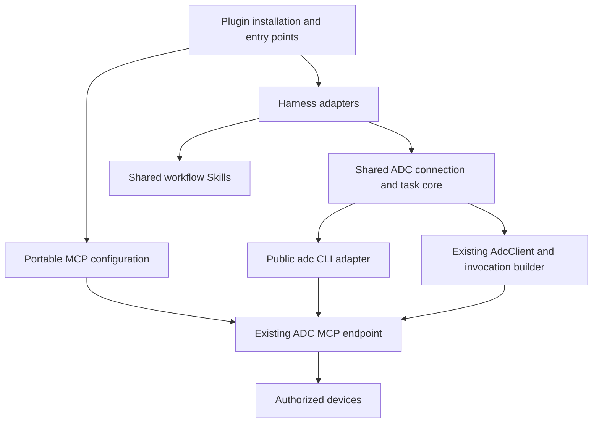

# ADC Harness Plugins

Status: core, adapters and distribution implemented; host validation and publication in progress.
See [verified host mechanisms](harness-plugin-research.md).

## Product behavior

Installing an ADC plugin gives the user an entry point in their existing harness. The first
workflow checks the current connection, guides account sign-in and device/access setup, and
verifies a read-only result. Later workflows reuse the connection and discover live capabilities.

Use these shared user concepts:

- **Connection**: service origin, signed-in/connected state, selected ADC authorization.
- **Devices**: online state, platform, authorized folders, current target.
- **Tasks**: queued/running/approval required/terminal state, result and receipt.
- **Review**: the existing ADC approval page; the human makes an independent decision.

The plugin must distinguish “installed”, “connected” and “a device is ready”. An empty device list,
an offline target, expired authorization and an unavailable tool each need a specific next action.
Do not create or pair the harness's own computer implicitly.

Zion gets a sidebar and status item. Its primary actions are **Connect ADC**, **Choose device**,
**Refresh**, **Open device setup**, **Open authorization settings**, and **Review approval**.
Show task progress and receipts in the same view. Use the host's typography, spacing, colors and
icons; avoid exposing tenant, internal transport or credential storage details in the product UI.

Visual thesis: a calm, compact native sidebar using the host's surfaces and one action accent.
Content plan: connection status, device selector and folders, task progress and receipts,
then links to device setup and authorization. Interaction thesis: immediate pending/disabled
states, a short button hover transition, and expandable task detail with reduced-motion support.

Terminal hosts get commands or prompt workflows with the same names and semantics. Use their
native notices, selection controls and tool result renderers where supported.

## Organization



Keep plugin source and distribution in the ADC repository. Package shared code into the final
artifacts so users do not need the monorepo or unpublished workspace dependencies.

Source layout:

```text
packages/harness-core/
  src/                 connection state, discovery, invocation, task projection
plugins/
  workflows/           shared plugin Skills and host-neutral instructions
  zion/                Workbench and Runtime entry points
  opencode/            plugin factory
  pi/                  extension factory and TUI commands
  cline/               AgentPlugin entry
  manifests/           portable and vendor metadata
scripts/build-plugins.ts
dist/plugins/          complete installable bundles, indexes and checksums
```

Generate portable Agent Plugins, Claude, Codex, Cursor, Copilot, Gemini and Droid component layouts
from the same workflows. Package executable adapters separately for Zion, OpenCode, Pi and Cline.
Keep every manifest path inside its package and validate complete archives, not just metadata.

Do not introduce a new task service, tool protocol or owner authentication system. Reuse
`AdcClient`, `buildInvocation`, current MCP discovery and the CLI where that is the host's public
connection interface.

## Authority and persistence

Portable MCP hosts own their OAuth connection. The bundle carries the public endpoint and
instructions; it contains no bearer token or secret. Do not add installation hooks that create
credentials, pair devices or authorize writes without a user workflow.

Local executable adapters can use the public `adc` CLI with explicit argument arrays and JSON
output. They must not inspect its private config or device identity. Keep owner management
commands in explicit setup/management workflows. Ordinary tool invocation uses only the scoped
Agent connection.

Zion is multi-user. Bind all connection state to the authenticated Runtime principal supplied
by the host, never an account ID from model arguments or browser request bodies. Reuse Plugin API
v2 state namespaces with an unambiguous per-user key. Keep scoped credentials in the Runtime;
the Workbench receives only public connection summaries.

The Zion connection UI should use ADC OAuth/DCR and PKCE so the user signs in and chooses
authorization on ADC's existing consent page. Persist only the scoped connection, not an owner
management session. Complete callback handling must verify state, principal, expiry, redirect
origin and PKCE. Expired or revoked connections return to the connection UI.

The current Zion account route policy needs a narrow addition for ADC command routing. Preserve
the server's independent `run.execute` check for mutations. Any host patch must be isolated from
the substantial existing user changes in the current Zion checkout.

## Execution contract

Discover live devices and tool definitions before invoking. Bind a target to the discovered
device and platform. Apply the existing schema, idempotency and task rules:

- Side effects use one stable idempotency key for the same requested operation.
- A quick wait can return a result or an existing task; waiting never resubmits the operation.
- `approval_required` leads to the user's ADC review page and later checks the same invocation.
- `denied` never switches devices or widens access.
- `offline` preserves the target and waits for reconnection.
- `unknown_outcome` requires reconciliation; never create a replacement operation.
- Stop pending child processes and requests on host cancellation or plugin disposal.
- Preserve invocation/task/receipt identities and keep output bounded.

Native generic tools should expose status, discovery, invocation and existing-task operations.
Tool arguments and tool identities come from current discovery, not a duplicated fixed list.
Use the host's effect and approval metadata for adapters that can invoke writes or commands.

## Distribution and validation

Publish downloadable bundles and install instructions on the official ADC site. Retain
marketplace manifests in the repository for hosts that install from Git. Native store submission
is separate from making a valid package and must not be reported as completed without acceptance.

Implement and verify in this order:

1. Shared connection/task core and workflow Skills.
2. Portable and vendor manifests, command layouts and deterministic package generation.
3. OpenCode, Pi and Cline executable adapters with lifecycle and cancellation behavior.
4. Zion sidebar, Runtime entry, account isolation and a compatible host policy patch.
5. Official download routes, website documentation, installation examples and checksums.
6. Contract tests, archive/source parity, adapter execution against isolated ADC fixtures,
   OAuth/state/expiry tests, and real host validation where locally available.
7. Build, lint, format and diff checks; commit only task files, publish packages and verify the
   official download interfaces. Preserve unrelated marketing and Zion changes.

The validation report must distinguish schema validation, real host loading, isolated ADC
execution and human account/consent steps. Do not use browser automation or require model-provider
credentials merely to test a plugin's registration and invocation boundaries.
